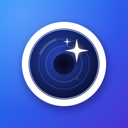
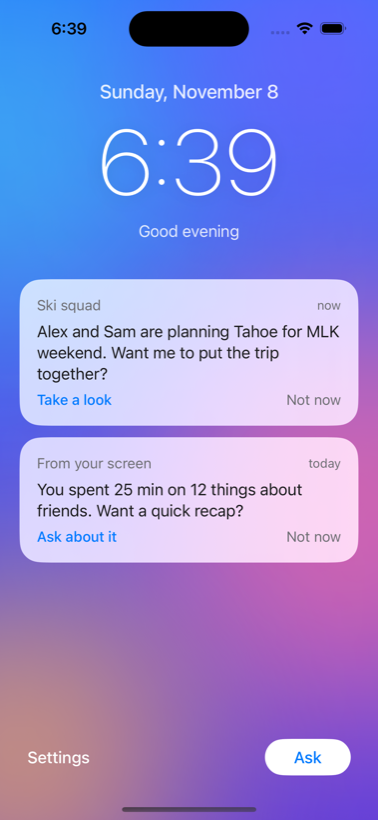
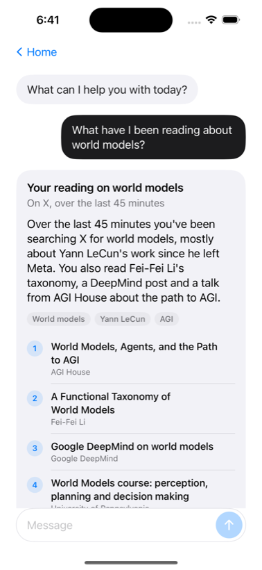
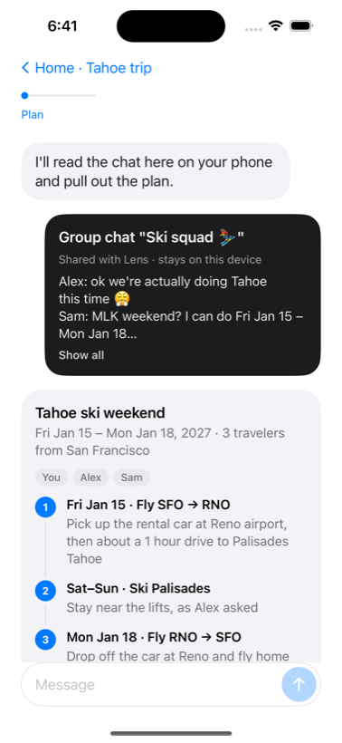
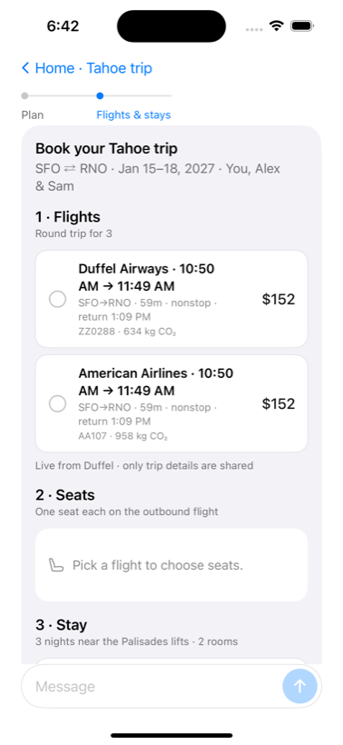
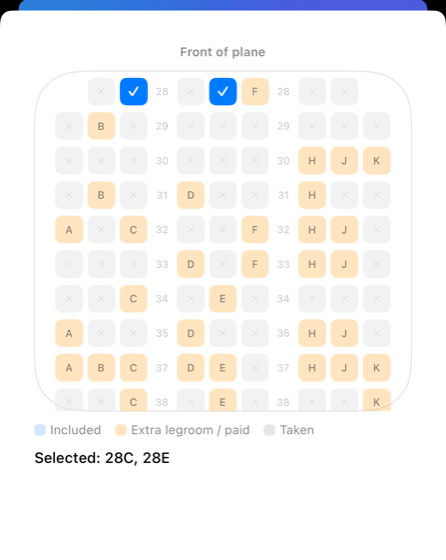
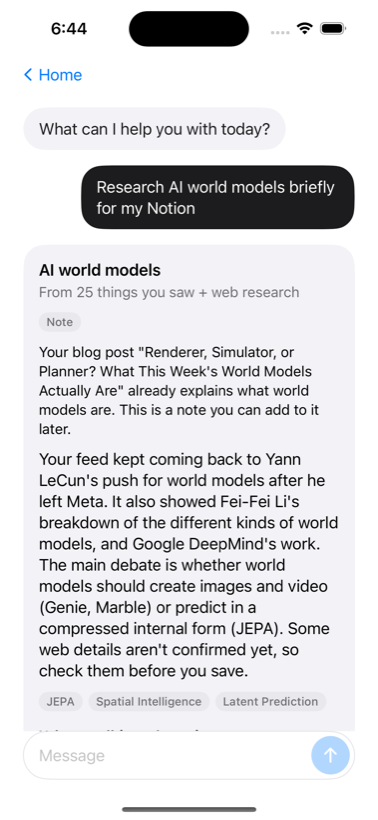
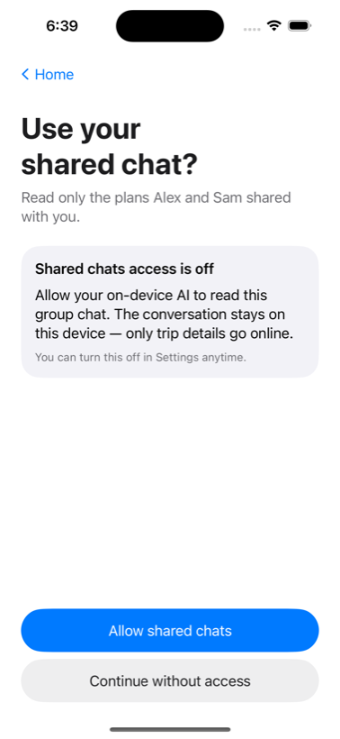
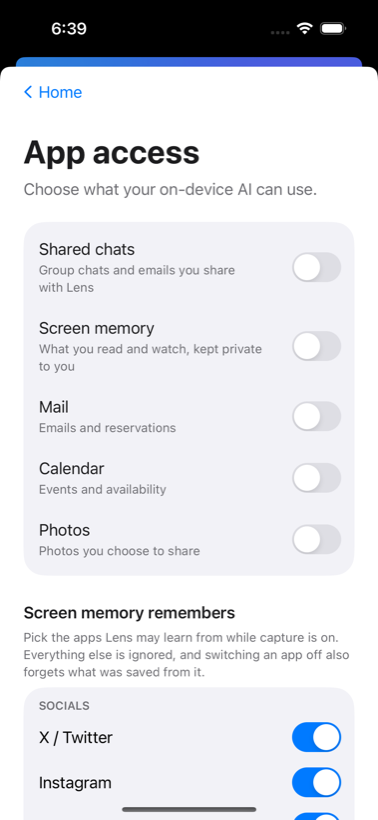

# Lens — a personal agent that remembers what you see



Built for **Hybrid AI in Action: From Personal Agents to Real-World Deployment Build Day**
(Lenovo × AGI House, Sunday Nov 8, 2026).

Lens is an iPhone agent that remembers what you read and watch on X, YouTube, Instagram and the
web, answers questions about it, plans and books trips your friends talk about in group chats,
and turns topics you research into a connected knowledge graph in Notion. Screenshots are read
by a **local** vision model, and only short text excerpts reach the **cloud** model. Every answer is
an interactive screen that the agent writes on the fly with [OpenUI](https://github.com/martinmitrevski/OpenUI)
and the app renders natively in SwiftUI.

<br clear="left">

| Home | Ask about your feed | Plan a trip from a group chat | Book flights, seats, stay, car |
|---|---|---|---|
|  |  |  |  |

| Live airline seat map | Research → Notion | Permission when needed | App access |
|---|---|---|---|
|  |  |  |  |

## What Lens does

**1. Screen memory.** Turn on **Settings → Screen memory** and iOS starts a screen broadcast
(the red status pill). The phone sends a screenshot every few seconds to the Lens server on your
laptop. A local vision model (Qwen2.5-VL via Ollama) extracts what's on screen: the app, post or
video titles, authors and topics. Identical screens only add viewing time. Lens never records
its own screens.

**2. You choose what it remembers.** In **Settings → Screen memory remembers**, socials (X,
Instagram, Facebook, TikTok, Reddit, LinkedIn, Threads), YouTube and web reading start on.
Messages, WhatsApp and unrecognised apps start off. Screens from apps that are switched off are
dropped before anything is saved, and switching an app off erases what was already saved from it.

**3. Ask.** "What did I just look at on my X feed?" or "What have I been reading about world
models?" Lens looks through your memory on the laptop and answers with when and what (for example
"About 4 minutes ago you were reading about…"), the topics as tags, and the posts. It answers only
what you asked.

**4. Trips from group chats.** Home suggests "Alex and Sam are planning Tahoe… Take a look".
Lens asks once for permission to read the shared chat, then:
- **Plan:** works out who is going, where and when, and shows an editable itinerary to confirm.
- **Book:** one booking screen with live [Duffel](https://duffel.com) flights, a native seat map
  for the chosen flight, a stay and a rental car, and a running total.
- **Pay:** a real Duffel test-mode order paid from the Duffel test balance, with the chosen seats
  included.
- **Share:** "Tell Alex & Sam" opens Messages with the itinerary filled in.

A step tracker (Plan → Flights & stays → Book → Share) follows along.

**5. Research to Notion, on demand.** "Research recursive self-improvement for my Notion" runs a
short web research that combines what you saw with who is behind it (real names, academic or
company affiliations, profile links) and which startups and labs work on it. Lens drafts a **blog
post** if the angle is new to your Notion, or a **note** if it isn't. Nothing is saved until you
tap **Add to Notion**. Each save extends a page graph that graph tools such as Graphify can draw:

```
🔭 Lens Research
├─ 🧭 <topic>            one cluster per topic: its post or note, plus the sources you saw
├─ 🧑‍🔬 People            shared across topics, so they connect the clusters
├─ 🏢 Organizations
└─ 🔑 Key phrases
```

Every page @mentions its neighbours: topic ↔ post ↔ people ↔ organizations ↔ key phrases ↔
sources.

## What runs where

| Step | Runs on | Why |
|---|---|---|
| Screen capture, permissions, rendering the UI | iPhone | Native and instant |
| Reading screenshots (vision) | **Local** model on the laptop (Qwen2.5-VL, Ollama) | Raw pixels never leave hardware you own |
| Memory: knowledge base, per-app rules, recall | **Local**: SQLite on the laptop | Your history stays on your machine |
| Planning, answering, writing the UI (OpenUI Lang) | **Cloud**: Claude (`claude-opus-5-5`) | Strong reasoning. It receives the question and matching text rows, never images |
| Flights, seat maps, orders | Duffel API (test mode) | Real airline inventory |
| Research web search, Notion export | Claude web search, Notion API | Only when you ask, and only the topic |

## How it fits together

```
iPhone (SwiftUI)
 ├─ Broadcast Upload Extension (ReplayKit) ── JPEG every 5 s ─────────────┐
 ├─ Home · Ask chat · Settings                                            │
 │    └─ OpenUI runtime renders the streamed UI natively;                 │
 │       custom components: OfferPicker, CabinSeatMap                     │
 └─ Query()/Mutation() in the UI → POST /tools/{name}                     │
                                    ▲                                     ▼
Laptop: FastAPI (backend/)          │
 ├─ /ingest/frame → dedup → LOCAL vision model → impressions, topics, people
 ├─ /agent/chat (SSE) → Claude + server tools:
 │     recall (local memory), research_topic (web search) → streams OpenUI Lang
 ├─ /tools/* → Duffel (search, seat maps, orders) · save_to_notion · price_trip
 └─ /settings/sources → which apps screen memory may keep
```

## Run it

**Backend** (needs [uv](https://docs.astral.sh/uv/) and [Ollama](https://ollama.com)):

```bash
ollama pull qwen2.5vl:7b
cd backend
cp .env.example .env     # ANTHROPIC_API_KEY, DUFFEL_ACCESS_TOKEN (duffel_test_…), NOTION_TOKEN
./run.sh                 # http://0.0.0.0:8000
uv run pytest -q         # offline tests
```

Keep keys in `backend/.env`, which git ignores. Never put them in `.env.example`.

**iOS app** (Xcode 16 with the iOS platform installed, and a real iPhone for screen capture):

```bash
brew install xcodegen
cd ios
cp Config/Local.xcconfig.example Config/Local.xcconfig   # team ID, bundle prefix, backend URL
xcodegen && open Lens.xcodeproj                           # rerun xcodegen after pulling
```

Run the **Lens** scheme. The phone and laptop must reach each other: same Wi-Fi, or Tailscale or
a phone hotspot if the venue network blocks it. The server address can also be changed under
**Settings → Developer**.

**Demo script:** turn on Screen memory, scroll X → Ask "what did I just look at on my feed?" →
Home → *Take a look* on Ski squad → *Looks good* → pick the Duffel Airways flight, 3 seats, a
stay and a car → Pay → *Tell Alex & Sam* → Ask "research world models for my Notion" →
*Add to Notion*.

## Current limits (be upfront in a demo)

- **Stays and cars are sample data.** Duffel Stays isn't enabled on our account (403) and Duffel
  Cars returns no test inventory, so those options come from a built-in catalog. Flights, seat
  maps and orders are real Duffel test mode.
- **Payment uses the Duffel test balance.** Card payments need Duffel's approval and their card
  component.
- **The local vision model takes about 5–15 s per new screen,** so the newest screens can lag
  behind. Lens says so when asked about "just now".
- **The OpenUI Swift package is pinned to its first commit.** It has no releases and no license
  file yet.
- **The Mail, Calendar and Photos switches** in Settings are placeholders. Shared chats and
  Screen memory are real.

## Developer notes

**Generative UI (OpenUI).** The agent's instructions are generated from the OpenUI component
library itself, plus our components and tools:

```bash
cd tools/openui-prompt && swift run    # writes backend/app/openui/system-prompt.md
```

Every example in it is parse-checked against the library before the file is written.
`backend/app/openui/tools.json` defines the tools the generated UI can call.

**Debugging memory.** With `LENS_DEBUG=true` (the default), every frame is written to
`backend/data/debug/<date>/` with the screenshot, the extracted JSON and a Markdown card.
`index.md` shows the timeline, `queries.md` and `agent.md` log questions and answers, and
`knowledge.md` is a live snapshot of the knowledge base. Compare vision models on the same frames:

```bash
uv run python -m app.replay data/debug/2026-11-08 --model qwen2.5vl:3b
```

**Simulator launch arguments (DEBUG builds):** `--preview-trip`, `--agent-autoconfirm`,
`--preview-ask "<question>"`, `--preview-seatmap`, `--preview-settings`, `--preview-permission`.

**App icon:** `uv run python ../tools/icon/make_icon.py` (from `backend/`) redraws it.

### API

| Endpoint | What |
|---|---|
| `POST /ingest/frame` | multipart `frame` (JPEG), `ts`, `device` |
| `POST /ingest/video` | multipart `video`, `every_s`: screen-recording fallback |
| `POST /agent/chat` | `{messages}` → Server-Sent Events streaming OpenUI Lang |
| `POST /tools/{name}` | tools called by the generated UI: `search_flights`, `get_seat_map`, `search_stays`, `search_cars`, `price_trip`, `book_trip`, `save_to_notion` |
| `GET/POST /settings/sources` | which apps screen memory may keep (switching one off forgets it) |
| `GET /impressions`, `/interests`, `/routes`, `/health` | inspection |
| `DELETE /data` | wipe the knowledge base |

## The problem space

Hybrid AI: deciding what a personal agent runs **on-device**, at the **edge**, and in the
**cloud**, and making those handoffs invisible. Personal context stays on hardware you own,
and frontier cloud models are called only when the task needs them.

## Repo layout

```
backend/   FastAPI: ingest + local vision, knowledge base, agent (Claude + OpenUI),
           Duffel travel, research + Notion graph
ios/       XcodeGen spec; SwiftUI app (Lens/), ReplayKit extension (LensBroadcast/), Shared/
tools/     openui-prompt (system prompt generator), icon (app icon generator)
docs/      notes, screenshots, earlier concert-flow prototype (docs/ui-demo.md)
```
