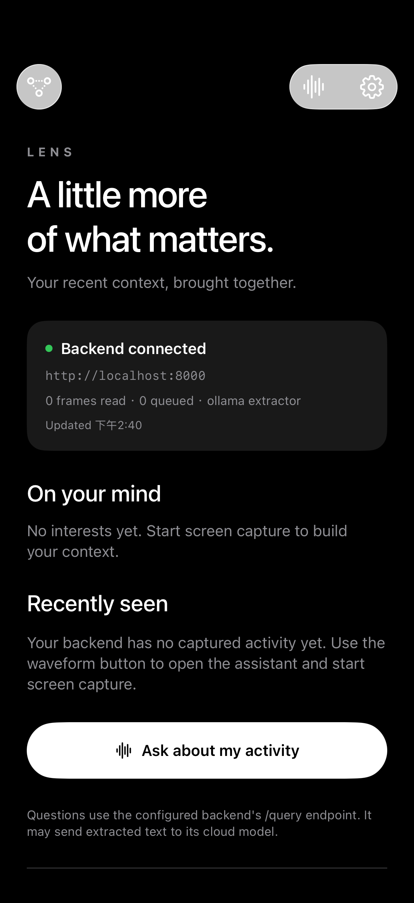

# iOS backend connection

The `ios-backend-connection` branch starts from merged `main` (`4b66379`). The home screen now reads the existing backend rather than displaying fictional personal activity.

| Page action | Existing endpoint | Behavior |
| --- | --- | --- |
| Load / pull to refresh home | `GET /health`, `/interests?type=topic&limit=5`, `/impressions?limit=5` | Shows backend status, interests and recent history; no model call |
| Tap a topic, history card, or Ask button | `POST /query` | Opens assistant, submits the question, renders returned `speech`, `ui`, and routing data |
| Settings → Test connection | `GET /health` at the entered address | Checks the address before saving |
| Routing toolbar | `GET /routes` | Existing route log |

Home has loading, retry, empty-database and stale-data states. Changing the backend address clears the previous server's displayed history. Concurrent refreshes cannot overwrite newer results. Closing settings triggers a refresh. Query submission clears the previous answer and disables repeated submission while it is in progress; errors offer a retry.

The concert walkthrough remains a separate labeled UI demo. No ticket, invitation, calendar or memory persistence endpoints exist in current main, so those steps do not call the backend.

## Configure and run

1. Configure `backend/.env` using `.env.example`, including the real model settings and API key, then start `backend/run.sh` as documented in the README.
2. In iOS Settings, use `http://localhost:8000` for the simulator on this Mac. For a physical iPhone, use the laptop's reachable LAN or Tailscale IP instead. The phone and laptop must be able to reach each other.
3. Tap **Test connection**, save, and return home. An empty database shows capture instructions. Open the waveform assistant to start ReplayKit capture, or ingest an existing recording using the documented backend API.
4. Pull to refresh, then tap an interest or history item to ask about it.

Reading home data does not invoke the cloud model. `/query` uses the backend's configured answer model and may send extracted text to the cloud. Existing assistant `open_url` actions retain their existing behavior.

## Verification

- All app Swift sources typechecked and compiled against the installed iOS simulator SDK.
- Six existing backend tests passed.
- `ios/Tests/check_ios_backend.py` starts a temporary instance of the production FastAPI app with its own SQLite database and one fictional history record. Only the model inference function is replaced with a deterministic answer. It compiles and runs the production Swift `LensAPI` client to verify health, topic filtering, history decoding, query body/source propagation, structured response decoding, HTTP 400 handling, and invalid URL handling. No app preferences, real history, or AI credentials are used.

```sh
uv run --project backend --group dev python ios/Tests/check_ios_backend.py
```

The integration test requires macOS, Xcode command-line tools, and the backend dependencies. If `xcode-select` points to CommandLineTools, prefix it with `DEVELOPER_DIR=/Applications/Xcode.app/Contents/Developer`.

The simulator was also connected to the actual backend running with an isolated empty database. The screenshot below shows that successful connection and the empty-history state. A connected health endpoint does not verify that Ollama or the cloud answer model is configured. Real-model answers, ReplayKit capture, and physical-device networking remain to be verified with the deployment's address and credentials. The full Xcode project/signing build has not been tested; the capture used a temporary simulator bundle.



## Local fake-mode web demo

Start with `cd backend && ./run.sh --fake`, then open `http://localhost:8000/demo`. For loopback-only access, use `LENS_FAKE_MODE=true uv run uvicorn app.main:app --host 127.0.0.1 --port 8000`. The demo page is only available in fake mode. The current local preview uses an isolated `/tmp/lens-local-demo-data` database.

The page calls the same FastAPI endpoints as iOS and renders their actual responses. Its phone-shaped panel is a web renderer, not a running iPhone or a SwiftUI screenshot. Timeline, person card, chart and preview-only open requests are available.

**Working:** HTTP calls, SQLite storage and reads, interest ranking, request validation, response schema, route logs, Web rendering; Swift client protocol integration and simulator home connection were also verified.

**Fake:** seeded browsing history, creators, durations, deterministic answers, and the simulated extractor. No Ollama or Claude call happens in fake mode. Uploaded images are not analyzed or used to create new history. The separate iOS concert flow remains UI-only, with no ticket search, purchase, invitation send, calendar write or persisted memory.

**Not yet verified end to end:** real model inference, physical-device network/capture, and voice.
