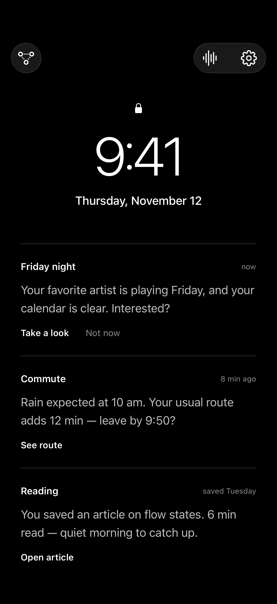
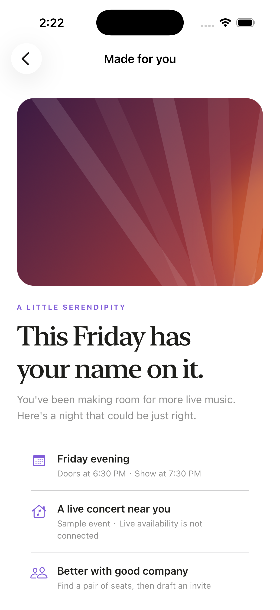
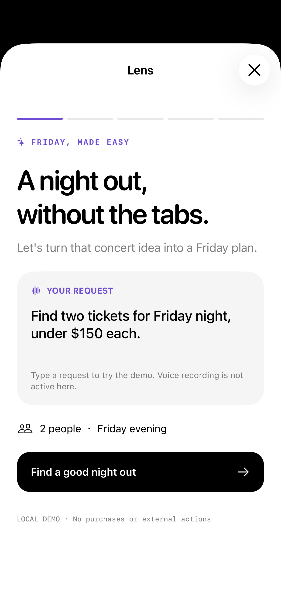

# Lens UI demo

Current SwiftUI implementation inspired by the [designer's Figma file](https://www.figma.com/design/SGuaSWlzANk6L27R8SqUgJ/Lenovo-AGI-Hackathon-Demo-11-8-2026?node-id=0-1).

## Screenshots

Actual app renders captured on an iPhone 17 Pro simulator (iOS 26.3), November 8, 2026. These are the initial viewport of each scrollable screen. The lock-screen clock and date are fixed design fixtures. This is an implementation preview; artwork is a bundled SwiftUI illustration and does not reproduce the designer's image assets.

| Personal suggestions | Concert detail | Ticket request |
| --- | --- | --- |
|  |  |  |

## Try the flow

1. Open the app and select **Take a look**.
2. Scroll through the concert detail and select **Find tickets**.
3. Review the request and the disclosure of what an online provider would receive.
4. Simulate an online search or stay offline to view fictional ticket options.
5. Choose a ticket, optionally filter for seated tickets, and review invitation/calendar drafts.
6. Finish the sample plan and optionally toggle temporary preference choices.

The waveform toolbar button opens the original voice/text assistant. Settings and routing logs remain accessible from the homepage toolbar.

All concert, ticket, invitation, calendar and preference content is local demo state. Nothing is purchased, sent, added to a calendar or persisted as memory. Editing the ticket request does not change the fixed sample results. Voice recording remains available in the original assistant; the ticket flow uses typed input.

## Validation and capture

The app's Swift sources passed typechecking against the installed iOS simulator SDK, and were compiled into a temporary simulator app bundle for these captures. XcodeGen is not installed in the capture environment, so this does not validate the generated Xcode project, signing, ReplayKit extension or physical-device behavior. Screen rendering was visually checked; the complete flow has not been exercised by automated UI tests.

Debug builds accept `--preview-concert` and `--preview-tickets` launch arguments to open those screens directly without invoking any external action. For an Xcode-generated Debug build already installed in a simulator:

```sh
xcrun simctl launch <device-id> <bundle-id> --preview-concert
xcrun simctl io <device-id> screenshot docs/screenshots/demo-concert.png
```

Terminate the app before relaunching with a different preview argument. Launch without preview arguments for the homepage.
